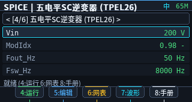
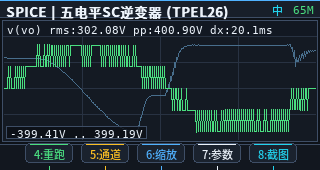
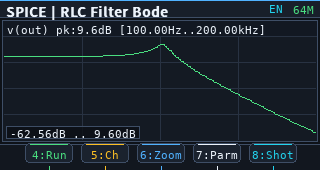
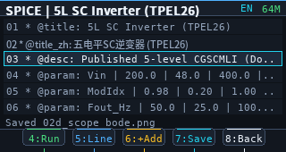
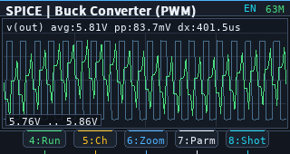
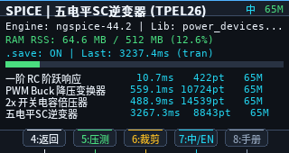
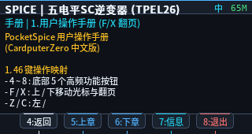

<div align="center">
  
  <h1>PocketSpice (<code>cp0-ngspice</code>)</h1>
  <p><strong>专为 M5Stack CardputerZero 打造的全功能掌上 NGSPICE 电路与电力电子仿真器</strong></p>
  <p>简体中文 ｜ <a href="README_EN.md">English</a></p>
</div>

---

## 项目简介

**PocketSpice（`cp0-ngspice`）** 是面向 **M5Stack CardputerZero**（Raspberry Pi CM0 / 四核 Cortex-A53 @ 1 GHz / 512 MB RAM / `320×170` ST7789v3 SPI LCD / 46 键矩阵键盘）的原生全功能 SPICE 电路仿真平台：

- **直接运行桌面级 `libngspice` C-ABI 内核**（无 X11/Xaw 冗余依赖，真机基于 `ngspice-44.2`）。
- **直驱硬件 `/dev/fb_lcd` 与 `tca8418c` `evdev`**：不依赖桌面窗口管理器，事件驱动零空转刷新，静止画面 CPU 占用接近 `0%`。
- **与桌面 NGSPICE 同等的网表灵活性**：支持 `.tran`、`.ac`（对数扫频 Bode 图）、`.dc`、`.op` 全分析类型，支持任意原生 `.cir`/`.sp` 网表自动发现、应用内网表行编辑器与常用功率开关器件库。
- **内置五电平开关电容逆变器（IEEE TPEL 2026）复刻**：冷启动即可在掌机上自均压输出 `±400V, ±200V, 0V` 五电平。
- **本地 AI Agent / ZClaw 无缝协同**：内置中英双语[用户手册](docs/USER_MANUAL_ZH.md)、[本地 AI 开发手册](docs/AI_AGENT_MANUAL_ZH.md)、[配方索引](docs/recipes.json) 及 `cp0-ngspice --json` 无头 CLI，自动扫描 `$HOME/.config/cp0-ngspice/projects/` 与 `$HOME/.zeroclaw/agents/zclaw/workspace/pocketspice/`。

---

## 真机 `320×170` 界面实拍

| 参数配置界面 | 五电平逆变器波形 | 通用示波 / Bode 扫频 | 网表行编辑器 |
| :---: | :---: | :---: | :---: |
|  |  |  |  |

| Buck 变换器波形 | 内存与性能遥测 | 应用内双语手册 | |
| :---: | :---: | :---: | :---: |
|  |  |  | |

---

## 核心特性与实测指标

### 1. 五电平开关电容逆变器论文复刻（[circuits/04_5level_sc_inverter.cir](circuits/04_5level_sc_inverter.cir)）
复刻自 *IEEE Transactions on Power Electronics* 2026 发表的五电平共地开关电容逆变器（CGSCMLI）：
> Zhifeng Dou, Haoran Liu, Falong Lu, Yongpeng Shen, Qian Wang, *"A Reverse Design Paradigm: Modular Constraint-Driven Reinforcement Learning for Automated Derivation of Switched-Capacitor Multilevel Inverters"*, *IEEE Trans. Power Electron.*, 2026 (`DOI: 10.1109/TPEL.2026.3683439`)

- **CardputerZero 真机 CLI 实测**（`40 ms` 冷启动仿真，`8843` 点）：
  - 求解耗时：**`3299.04 ms`**
  - 进程常驻内存 RSS：**`33.73 MB`**（`< 512 MB` 的 7%）
  - 输出五电平端口电压：`v(vo) = -399.41 V .. +399.19 V`
  - 开关电容自均压稳态均值：`V(C1) = 199.03 V`（≈ `Vin`）、`V(C2) = 397.04 V`（≈ `2·Vin`）

### 2. 全能 SPICE 网表支持与 512 MB 内存防线
- 支持 `.include power_devices.lib` 复用 [lib/power_devices.lib](lib/power_devices.lib) 中的功率半导体子电路（`IGBT_DIODE`、`BIDIR_IGBT`、`MOSFET_SW`、`POWER_DIODE`）。
- 兼容 `@param`（含 `100k` / `100u` / `1m` 等标准 SPICE 工程后缀，同步更新 `{Param}` 与 `.param` 字面量）以及无任何 `@` 注解的任意原生 `.cir`/`.sp` 文件。
- 运行后立即执行 `destroy all` + `remcirc` 释放内部波形缓冲，并默认启用 `.save` 节点裁剪与单例 C 回调锁，避免多次仿真泄漏或崩溃。

### 3. 本地 AI / 终端 CLI（[cp0_ngspice/cli.py](cp0_ngspice/cli.py)）
```bash
cp0-ngspice manual --topic ai --lang zh   # 读取本地 AI 建模手册
cp0-ngspice list --json                    # 列出内置模板与用户/ZClaw工程
cp0-ngspice new my_buck --from 02_buck_converter
cat custom.cir | cp0-ngspice new my_cir --stdin
cp0-ngspice validate my_cir                # 语法与 .save 内存校验
cp0-ngspice run my_cir --json              # 无头运行并输出 JSON 统计指标
```

---

## 按键操作说明（适配 `cp0-keys` 46 键布局）

| 按键 | 功能 |
| :--- | :--- |
| **`4 ~ 8`** | 底部 5 键快捷操作栏（运行仿真 / 编辑保存 / 切换网表 / 切换波形与缩放 / 翻阅手册与截屏） |
| **`F / Z / X / C`** 或方向键 | 上 / 左 / 下 / 右导航、切换电路模板或步进微调选中参数 |
| **`Enter`** | 编辑选中参数值或当前网表行（支持 M5Stack 符号层直接输入 `-` `.` `=` 等字符） |
| **`L`** | 实时切换界面与手册语言（**简体中文 / English**）并持久化保存 |
| **`H`** | 呼出 / 关闭快捷帮助浮层 |
| **`Esc`** | 取消编辑 / 返回主目录 / 退出应用返回 `APPLaunch` 桌面（长按由启动器兜底退出） |

---

## 目录结构

```text
cp0-ngspice/
├── app-builder.json              # CardputerZero AppStore 元数据清单
├── assets/                       # 应用图标（256×256 商店版 & 100×100 启动器版）
├── circuits/                     # 内置典型电路（RC、Buck、倍压电荷泵、五电平SC逆变器、Bode）
├── lib/power_devices.lib         # 公共电力电子开关器件模型库
├── docs/                         # 中英双语用户手册、AI Agent 手册与 recipes.json 配方索引
├── cp0_ngspice/
│   ├── cli.py                    # 无头 CLI 与 JSON 数据接口
│   ├── engine/                   # libngspice C-ABI 封装、通用解析器、项目发现与指标统计
│   └── ui/                       # 320×170 五屏交互、/dev/fb_lcd + evdev 后端、字形缓存
├── packaging/build_deb.sh        # arm64 .deb 一键打包脚本
├── scripts/                      # 桌面调试、批量截图与商店发布辅助脚本
└── tests/                        # 11 项核心引擎/CLI/帧缓冲/键码映射测试
```

---

## 安装、开发与测试

### CardputerZero 真机安装与构建 `.deb`
1. 通过 **CardputerZero AppStore** 搜索 **`PocketSpice`** 或输入分享码 **`SPIC`** 一键安装。
2. 或在 CardputerZero（Debian `arm64`）上源码打包安装：
```bash
sudo apt-get update && sudo apt-get install -y libngspice0 python3-pygame python3-numpy python3-psutil
bash packaging/build_deb.sh
sudo apt-get install -y ./dist/cp0-ngspice_0.2.0-1_arm64.deb
```

### 桌面端预览与单元测试（Windows / Linux）
需要隔离环境（Python 3.10+、`libngspice`/`ngspice-lib`、`pygame`、`numpy`、`psutil`）：
```bash
# 运行全部 11 项单元测试
python -m unittest discover -s tests -v

# 启动 3x 放大桌面端调试窗口（Linux 桌面可加 CP0_WINDOWED=1）
python -m cp0_ngspice.ui.app

# 无头运行全套内置电路验证并导出 320x170 中英截图
python scripts/verify_prototype.py
```

---

## 开源协议

基于 [MIT License](LICENSE) 开源发布。
